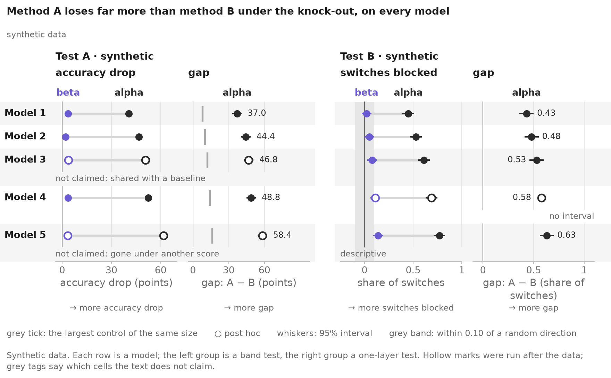
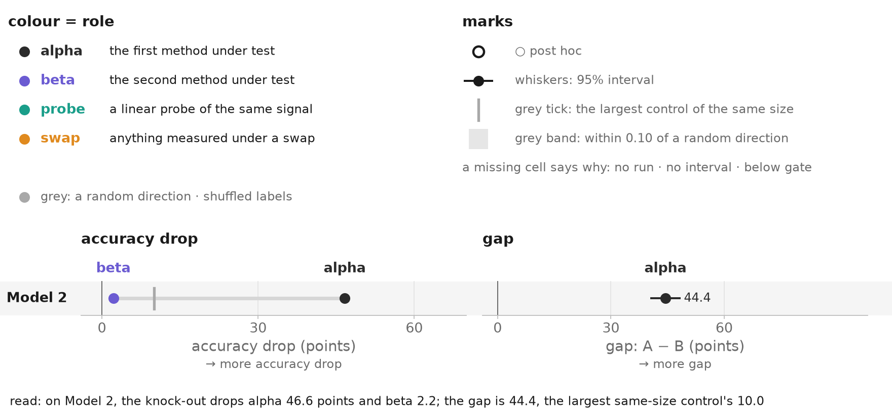
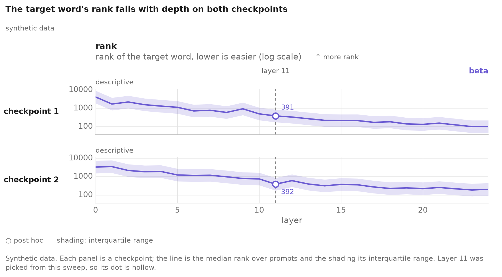
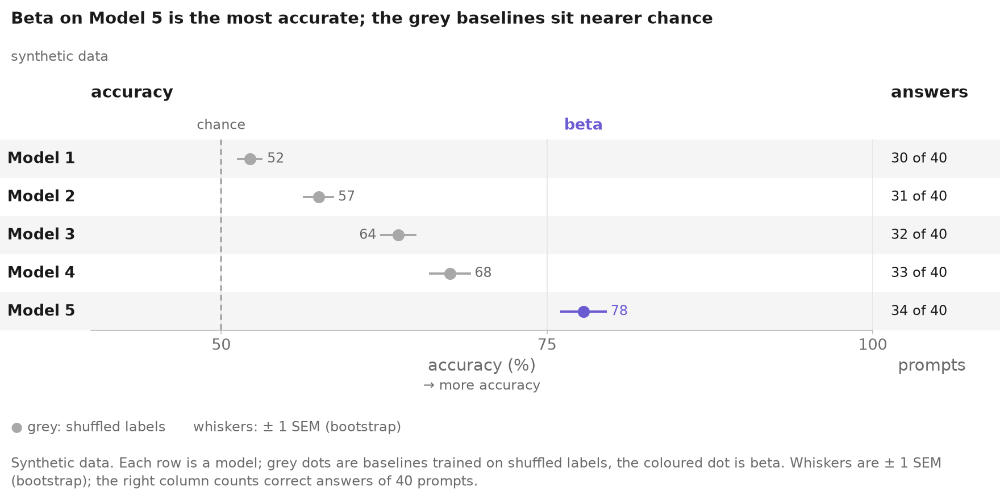

# styles-plot

One figure grammar shared across research projects, for matplotlib. Colour means a role; a hollow mark means post hoc;
the key is built from what was drawn; every word comes from the project's vocabulary; every number goes through its
unit's formatter; and `save` refuses a figure that breaks any of it.

**The library owns the grammar. Each project owns its vocabulary** (`plotstyle.toml`: roles, words, units, entities,
the status registry) **and its style** (palette, marks, fonts, sizes, targets, wording), all with defaults.

## What you get



Colour is a role; hollow = post hoc; grey tags say what the text does not claim; the key lists only what is drawn.



The project's grammar on one image (`styles-plot key`).



A quantity over layers; shading names its interval; the picked layer is a dot that keeps its status.



Grey is a control and nothing else; a chance line; counts print as "k of n".

## Quick start

```
pip install "styles-plot @ git+https://github.com/danorel/styles-plot@v0.1.15"
styles-plot init                 # plotstyle.toml, status.csv, first_figure.py
python first_figure.py           # figures/post/first_figure.png, figures/readme/first_figure.png (strict)
styles-plot check figures/post --vocab plotstyle.toml
```

`first_figure.py`, as `init` writes it:

<!-- first-figure:start -->
```python
"""A first figure on synthetic data. Replace the data with yours and register each cell in status.csv."""

from pathlib import Path

import numpy as np

import styles_plot as sp

HERE = Path(__file__).resolve().parent
v = sp.load(HERE / "plotstyle.toml")
models = [e.key for e in v.entities("models")]  # rows in the vocabulary's order

rng = np.random.default_rng(0)  # synthetic data
ours = {m: 72 + 8 * i + rng.normal(0, 2) for i, m in enumerate(models)}
base = {m: 56 + rng.normal(0, 3) for m in models}
half = {m: 3 + rng.uniform(0, 2) for m in models}  # half the width of a 95% interval
right = {m: round(ours[m] / 100 * 40) for m in models}  # correct answers out of 40 prompts


def est(acc, m, key=None):
    return sp.Est(acc[m], acc[m] - half[m], acc[m] + half[m], cell=f"acc.{m}", key=key, label=key is not None)


col = sp.DotColumn("accuracy", "accuracy", (40, 100), (50, 75, 100),
                   series=[sp.Series("control", {m: est(base, m) for m in models}, control="shuffled labels"),
                           sp.Series("method", {m: est(ours, m, f"acc.{m}") for m in models})],
                   rules=[sp.Rule(50, "chance")])  # fmt: skip
counts = sp.TextColumn("answers", "prompts", {m: sp.Count(right[m], 40, cell=f"acc.{m}", key=f"n.{m}") for m in models})

fig = sp.Figure("first_figure", v, subtitle="synthetic data",
                title="Our method beats the shuffled-label baseline on every model",
                caption="Synthetic data. Each row is a model; whiskers are 95% intervals; Model 3 was run after the data.")
fig.add(sp.DotTable(models, [col, counts], kind="models"))
for target, report in sp.save_bundle(fig, HERE / "figures", targets=("post", "readme")).items():
    print(f"{target}: {report.path}")
```
<!-- first-figure:end -->

## What strict mode refuses

A header word missing from the vocabulary and a cell missing from the registry ([examples/refused.py](examples/refused.py)):

<!-- refused:start -->
```
2 problem(s), nothing written:
  refused: SP203 cell 'acc.m2' is not in the registry for figure 'refused'
  refused: SP401 header 'recall' is not in the vocabulary
```
<!-- refused:end -->

To migrate an old script, save with `mode="compat"`: it writes the figure, warns, and records each problem in the
sidecar until you fix them.

## Make it yours

| what you change | where | how |
|---|---|---|
| what each colour means, and its word | `[roles]` in `plotstyle.toml` | [ADOPTING.md §2](docs/ADOPTING.md#2-write-the-vocabulary-plotstyletoml) |
| axis titles, cues, number formats | `[units]` | [ADOPTING.md §2](docs/ADOPTING.md#2-write-the-vocabulary-plotstyletoml) |
| every other word a figure prints | `[terms]` | [ADOPTING.md §2](docs/ADOPTING.md#2-write-the-vocabulary-plotstyletoml) |
| the rows and their order | `[[entities.<kind>]]` | [ADOPTING.md §2](docs/ADOPTING.md#2-write-the-vocabulary-plotstyletoml) |
| hollow or filled, claimed or not | `status.csv` | [ADOPTING.md §3](docs/ADOPTING.md#3-write-the-status-registry) |

## Figure types

- **Dot table**: estimates per entity and condition, with intervals, connectors, grey ticks and text columns.
- **Sweep**: a quantity over depth, stacked per entity, with interval bands and points.
- **Distribution**: histograms or strips per entity and condition.
- **Stack**: 100% splits per entity.
- **Scatter**: embeddings, or two quantities, with named clouds.
- **Schematic** and **Card**: boxes, arrows and coloured words; a real item's prompt and answers.

The full table is in [ADOPTING.md](docs/ADOPTING.md#figure-types).

## Commands

```
styles-plot init [DIR]                                  # a starter vocabulary, registry and figure
styles-plot check figures/post --vocab plotstyle.toml   # PNGs and sidecars: size, palette, staleness, numbers
styles-plot sheet figures/post                          # contact sheets, colour and gray
styles-plot key --vocab plotstyle.toml                  # the project's grammar on one image
styles-plot palette --vocab plotstyle.toml              # colour-vision distances; pairs that may not share a figure
```

## Rebuild the examples

- `make gallery`: every example for every target into `gallery/` (not committed), with contact sheets.
- `make readme-images`: the four README images into `examples/figures/`.
- `make readme`: the generated README blocks.
- CI builds and checks the full gallery on every push to `main` and every pull request, and uploads it as the
  `gallery` artifact.

## Docs, install, licence

- [docs/GRAMMAR.md](docs/GRAMMAR.md): the rules and the checks.
- [docs/ADOPTING.md](docs/ADOPTING.md): writing a vocabulary, porting a script.
- [docs/DESIGN.md](docs/DESIGN.md): the design and its decisions.
- [CHANGELOG.md](CHANGELOG.md): each release, with migration notes.

Install from a tag (no PyPI): `styles-plot @ git+https://github.com/danorel/styles-plot@v0.1.15`; add the `[check]`
extra only for custom palette hexes. Python ≥ 3.10, matplotlib ≥ 3.8, numpy ≥ 1.26. The public API is
`styles_plot.__all__`; modules starting with `_` are internal. MIT licence ([LICENSE](LICENSE)).
